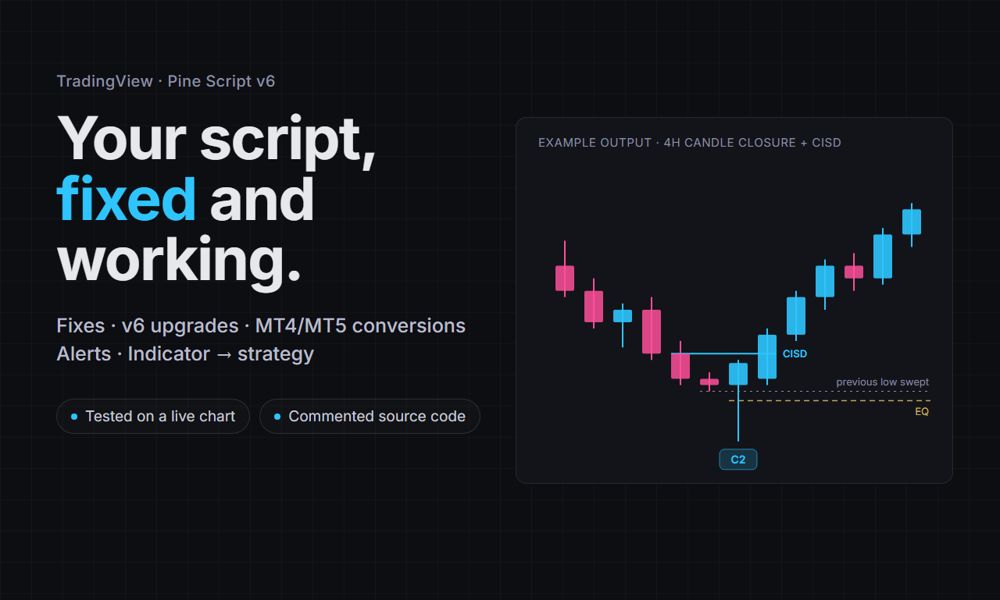
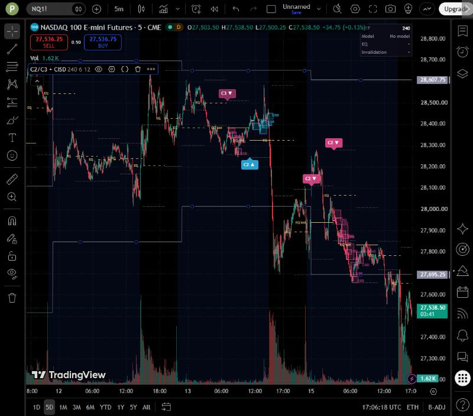
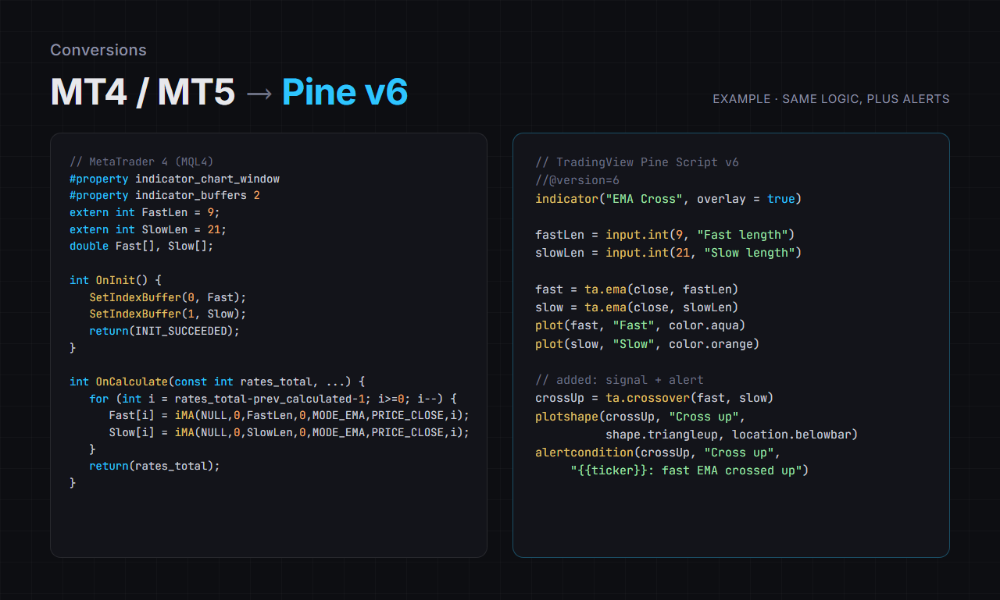
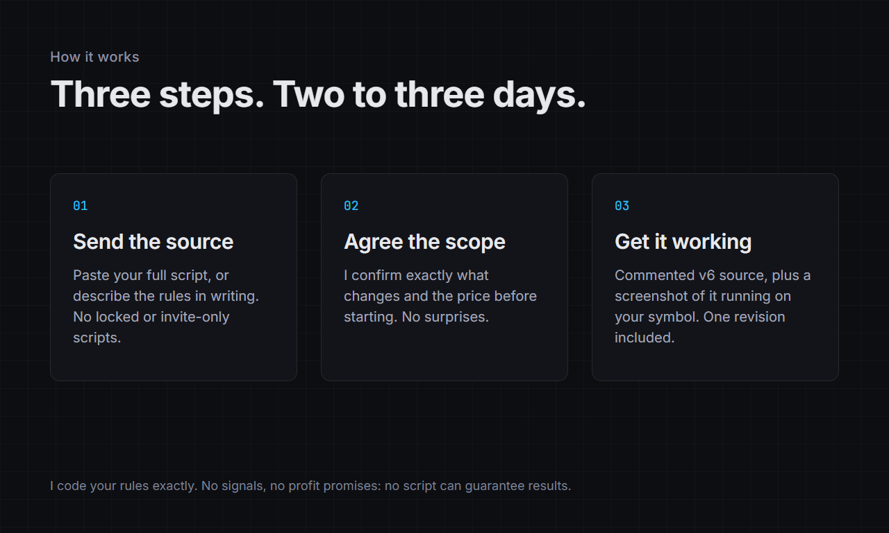

# PineSmith: TradingView Pine Script

Clean, commented **Pine Script v6** for TradingView, tested on a live chart before delivery.

## Scripts
| Script | What it does |
|---|---|
| [Candle Closures + CISD](candle-closures-cisd/) | Marks higher-timeframe candle 2 / candle 3 closures, their EQ, and the lower-timeframe CISD + order block that follows. Multi-timeframe, non-repainting, with alerts. |
| [MQL4 → Pine conversion example](examples/mql4-to-pine-ema-cross/) | The same EMA-cross indicator in MQL4 and in Pine v6, with alerts added in the conversion. |

## What I do
- **Fix** broken scripts and compile errors, including after TradingView updates
- **Upgrade** Pine v4/v5 scripts to **v6**
- **Convert** MT4/MT5 (MQL4/MQL5) indicators to Pine Script

  
- **Add** alerts, inputs, tables, labels and multi-timeframe values
- **Turn indicators into strategies** for the Strategy Tester, with realistic commission and slippage

## How it works

1. Send the full source code, or a clear written spec.
2. I confirm the scope and price before starting.
3. You get commented source code plus a screenshot of it running on your symbol. One revision is included.

**What I won't do:** promise profits, sell signals, or edit protected/invite-only scripts without the source.

## Hire me
- Fiverr: *coming soon*
- Upwork: *coming soon*

---
Scripts are released under the [Mozilla Public License 2.0](LICENSE). They're educational tools and not financial advice.
