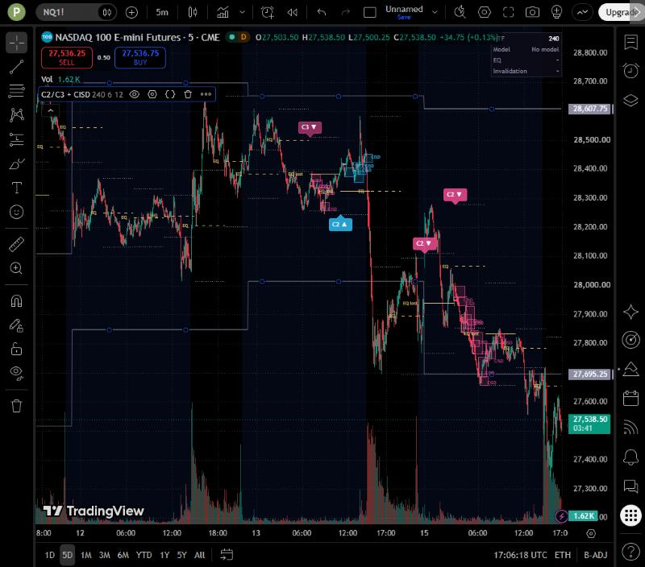

# Candle Closures + CISD (Pine Script v6)

An indicator that marks higher-timeframe **candle closure formations** and the lower-timeframe **change in state of delivery (CISD)** that often follows them. It's a charting aid for studying how candles sweep and reject each other's ranges. It doesn't predict outcomes and isn't a buy/sell signal.

**Install:** open TradingView's Pine Editor, paste [`candle_closures_cisd.pine`](candle_closures_cisd.pine), then click **Save** and **Add to chart**.

## What it marks
Candles are named **p** (the HTF candle that just closed), **q** (the one before) and **r** (the one before that).

| Mark | Rule |
|---|---|
| **C2** (candle 2 closure) | p trades beyond q's high or low, then closes back inside q's range |
| **C3** (candle 3 closure) | q ran beyond r's extreme and closed beyond it; then p holds q's extreme and closes back through q's body |
| **EQ** | The previous HTF candle's 50% (close-to-wick for a C2 that closed against the swing). If a chart-timeframe close goes beyond it, the label shows "EQ lost" and the expected direction is cleared for that HTF candle |
| **CISD** | A chart-timeframe candle closes beyond the open of the first candle in the latest opposing run. The last opposing candle is boxed as the order block |
| **Continuation (C4)** | After a C3 whose next candle closes beyond the previous extreme, the expected direction carries one more candle |

There's also an optional **key-level filter** (off by default). With it on, a closure is only marked when its wick also took the previous day's high/low, or the extreme of the last N HTF candles.

## How to use it
1. Set **HTF candle to read** above your chart timeframe. Common pairs: a 4H HTF on a 15m chart, or 1H on a 5m chart.
2. By default, CISDs only show while the expected HTF candle is forming, in its direction. Turn that off to see every CISD.
3. The status panel shows the HTF, the expected direction, the EQ, and the swing extreme that would invalidate the idea.
4. Alerts are available for C2 and C3 closures, CISDs in the expected direction, and EQ lost.

## Notes
- HTF values come from **completed candles only** (`request.security` with offset history), so closed formations don't repaint.
- The formations are descriptive and often fail, especially away from meaningful levels. Use them with your own analysis and risk management.
- Order blocks and CISD levels are drawn mechanically. Discretionary traders may define them differently.

*Educational tool, not financial advice.*
